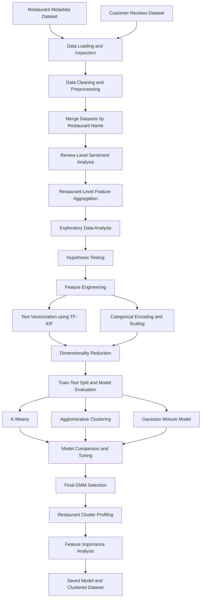

# Zomato Restaurant Segmentation Using Customer Reviews and Sentiment Analysis

An unsupervised machine learning project that analyses Zomato restaurant information and customer reviews to identify restaurant segments based on ratings, customer sentiment, cost, cuisines, and other restaurant characteristics.

The project combines **Exploratory Data Analysis, Natural Language Processing, Sentiment Analysis, Feature Engineering, and Clustering Algorithms** to discover patterns in restaurant performance and customer experiences.

---

## Project Overview

Zomato contains a large amount of restaurant information and customer feedback. However, identifying meaningful patterns across restaurants can be challenging when ratings, reviews, pricing, cuisines, and customer experiences are considered separately.

This project aims to group restaurants with similar characteristics using unsupervised machine learning. Customer reviews are analysed using VADER sentiment analysis, while restaurant-level features are created from ratings, review behaviour, pricing, and restaurant metadata.

Three clustering algorithms are implemented and evaluated:

- K-Means Clustering
- Agglomerative Clustering
- Gaussian Mixture Model (GMM)

The tuned Gaussian Mixture Model was selected as the final model based on the defined evaluation and stability criteria.

## Objectives

- Analyse restaurant metadata and customer reviews.
- Understand customer opinions through sentiment analysis.
- Explore relationships between restaurant ratings, costs, cuisines, and reviews.
- Engineer meaningful restaurant-level features.
- Apply dimensionality reduction to prepare data for clustering.
- Compare multiple unsupervised machine learning algorithms.
- Identify distinct restaurant segments and interpret their characteristics.
- Analyse important features influencing cluster membership.

## Dataset

The project uses two datasets:

| Dataset | Description | Records |
|---|---|---:|
| Restaurant Metadata | Restaurant names, cost, cuisines, collections, timings, and other attributes | 105 |
| Restaurant Reviews | Customer reviews, ratings, reviewer information, timestamps, and pictures | 10,000 |

The datasets are combined using restaurant names as the linking key.

After preprocessing and aggregation, the analysis is performed at the **restaurant level**, rather than treating every individual review as a separate clustering sample.

### Important Features

Some of the features used in the analysis include:

- Restaurant cost
- Average customer rating
- Rating standard deviation
- Positive and negative review percentages
- Average sentiment score
- Average review length
- Number of reviews
- Reviewer activity and follower information
- Picture-related statistics
- Cuisine and collection information

## Project Architecture

The following diagram represents the overall data processing and machine learning workflow.



## Methodology

### 1. Data Loading and Understanding

- Loaded restaurant metadata and customer review datasets using Pandas.
- Examined dataset dimensions, data types, missing values, and duplicate records.
- Identified relevant variables for further analysis.

### 2. Data Cleaning and Wrangling

- Handled missing values and duplicate records.
- Performed data type conversions and text cleaning.
- Combined the restaurant and review datasets using restaurant names.
- Prepared the data for exploratory analysis and feature engineering.

### 3. Sentiment Analysis

VADER (Valence Aware Dictionary and sEntiment Reasoner) was used to analyse customer reviews.

Each review was assigned a compound sentiment score and classified into one of three categories:

- **Positive:** Compound score greater than 0.05
- **Neutral:** Compound score between -0.05 and 0.05
- **Negative:** Compound score below -0.05

Additional review-level information, such as review length and reviewer activity, was also processed.

The review information was then aggregated at the restaurant level to calculate sentiment percentages, average ratings, review statistics, and other behavioural features.

### 4. Exploratory Data Analysis

Exploratory Data Analysis was performed to understand patterns and relationships among:

- Restaurant ratings and cost.
- Customer sentiment distribution.
- Restaurant cuisines and collections.
- Reviewer activity and ratings.
- Customer reviews and picture uploads.
- Relationships between numerical variables.

Visualizations such as distribution plots, count plots, box plots, correlation heatmaps, and pair plots were used.

### 5. Hypothesis Testing

Three statistical tests were performed to investigate relationships in the dataset.

| Hypothesis | Statistical Test | p-value |
|---|---|---:|
| Difference between critic and regular reviewer ratings | Mann–Whitney U Test | 0.00269 |
| Rating differences across cost categories | Kruskal–Wallis Test | 0.00335 |
| Relationship between picture presence and sentiment | Chi-square Test | p < 0.05 |

The results provided statistical evidence of differences in reviewer ratings, ratings across cost categories, and an association between picture presence and sentiment.

### 6. Feature Engineering and Preprocessing

The following techniques were applied:

- Missing value imputation and outlier handling.
- Categorical feature encoding.
- Text preprocessing, including lowercasing, punctuation removal, stopword removal, and normalization.
- Feature manipulation and selection.
- Data transformation and feature scaling.
- Train-test splitting using an 80:20 ratio, stratified by cost category.

**Text Feature Extraction:**

TF-IDF (Term Frequency–Inverse Document Frequency) was applied to restaurant-level review text using unigrams and bigrams.

**Dimensionality Reduction:**

- PCA was applied to the behavioural and categorical feature space, retaining 90% of the variance.
- Truncated SVD was applied to the TF-IDF text representation to generate 10 text components.

The resulting feature representations were used to evaluate different clustering configurations.

### 7. Clustering Model Implementation

Three unsupervised learning algorithms were implemented.

| Algorithm | Purpose |
|---|---|
| K-Means | Groups restaurants based on distances from cluster centroids. |
| Agglomerative Clustering | Builds hierarchical clusters by progressively merging similar observations. |
| Gaussian Mixture Model | Models clusters as a mixture of probability distributions. |

Hyperparameter tuning was performed using GridSearchCV and cross-validation.

Different cluster counts, initialization methods, linkage methods, and covariance configurations were evaluated, depending on the algorithm.

### 8. Model Evaluation and Selection

The clustering algorithms were evaluated using the following metrics:

- **Silhouette Score:** Measures how well-separated the clusters are. Higher values are preferred.
- **Davies-Bouldin Index:** Measures similarity between clusters. Lower values are preferred.
- **Calinski-Harabasz Score:** Measures cluster compactness and separation. Higher values are generally preferred.
- **Stability ARI:** Measures the consistency of cluster assignments across repeated subsampling experiments. Higher values indicate greater stability.

The final model was selected using a predefined rule: models within 0.01 of the best test Silhouette Score were considered eligible, and the model with the highest stability ARI was selected.

## Model Performance

The following table shows the evaluated clustering configurations.

| Model | Test Silhouette | Test Davies-Bouldin | Test Calinski-Harabasz | Stability ARI |
|---|---:|---:|---:|---:|
| K-Means (Baseline) | 0.202 | 1.374 | 6.514 | 0.875 |
| K-Means (Tuned) | 0.202 | 1.374 | 6.514 | 0.875 |
| Agglomerative (Baseline) | 0.195 | 1.377 | 5.758 | 0.612 |
| Agglomerative (Tuned) | 0.166 | 1.681 | 5.799 | 0.558 |
| GMM (Baseline) | 0.172 | 1.552 | 5.229 | 0.704 |
| **GMM (Tuned)** | **0.203** | **1.295** | **6.084** | **0.916** |

The tuned GMM was selected as the final model. It achieved the highest test Silhouette Score among the evaluated models and the highest stability ARI.

## Final Restaurant Segments

The selected model identified two distinct restaurant clusters.

| Characteristic | Cluster 0 | Cluster 1 |
|---|---:|---:|
| Number of Restaurants | 68 | 32 |
| Average Cost | 1034.6 | 501.6 |
| Average Rating | 3.759 | 3.264 |
| Positive Reviews | 82.1% | 57.6% |
| Negative Reviews | 14.9% | 26.0% |

### Cluster 0 – Higher-Rated Restaurant Segment

This segment generally contains restaurants with:

- Higher average cost.
- Better average customer ratings.
- A greater proportion of positive reviews.
- More customer pictures and critic reviews.
- A wider variety of cuisines and collections.

Some example restaurants identified in this cluster include:

- Beyond Flavours
- Paradise
- Flechazo
- Shah Ghouse Hotel & Restaurant
- Over The Moon Brew Company

### Cluster 1 – Lower-Cost Restaurant Segment

This segment generally contains restaurants with:

- Lower average cost.
- Comparatively lower average ratings.
- A higher proportion of negative reviews.
- More delivery-related review terms.

Some example restaurants identified in this cluster include:

- Shah Ghouse Spl Shawarma
- KFC
- Hotel Zara Hi-Fi
- Pakwaan Grand
- 13 Dhaba

These segments help highlight differences in restaurant characteristics and customer experiences. They represent patterns discovered by the clustering model, rather than predefined restaurant categories.

## Model Explainability

A Random Forest surrogate classifier was used to understand which original features were associated with the cluster assignments produced by the selected GMM.

The surrogate model achieved a cross-validation balanced accuracy of:

**0.938 ± 0.058**

Permutation importance was used to identify influential features.

Some of the most important features were:

1. Percentage of neutral reviews
2. Percentage of positive reviews
3. Average adjusted share
4. Average number of pictures
5. Number of collections
6. Rating standard deviation
7. Average reviewer followers
8. Percentage of critic reviews
9. Restaurant cost

This analysis indicates that customer sentiment and restaurant characteristics play an important role in distinguishing the identified segments.

## Technology Stack

| Category | Tools and Libraries |
|---|---|
| Programming Language | Python |
| Data Manipulation | Pandas, NumPy |
| Data Visualization | Matplotlib, Seaborn |
| Sentiment Analysis | VADER Sentiment |
| Text Processing | NLTK, Scikit-learn |
| Machine Learning | Scikit-learn |
| Clustering | K-Means, Agglomerative Clustering, Gaussian Mixture Model |
| Dimensionality Reduction | PCA, Truncated SVD |
| Model Explainability | Random Forest, Permutation Importance |
| Model Serialization | Joblib |
| Development Environment | Jupyter Notebook |

## Project Structure

```text
Zomato-Restaurant-Segmentation/
│
├── ML_Submission.ipynb
│
├── Names_and_Metadata.csv          # Restaurant metadata dataset
├── Restaurant_reviews.csv          # Customer reviews dataset
│
├── zomato_cluster_model.joblib     # Saved model and preprocessing bundle
├── zomato_restaurant_clusters.csv  # Restaurant cluster assignments
│
└── README.md
```

*Note: The CSV datasets and generated output files should be added to the repository if you intend to distribute them. The notebook expects the two input CSV files in its working directory.*

## How to Run the Project

### 1. Clone the Repository

```bash
git clone https://github.com/RachanaFPatil/Zomato-Restaurant-Segmentation.git
```

### 2. Navigate to the Project Directory

```bash
cd Zomato-Restaurant-Segmentation
```

### 3. Install Dependencies

```bash
pip install pandas numpy matplotlib seaborn scikit-learn scipy nltk vaderSentiment joblib jupyter
```

### 4. Add the Dataset Files

Place the following CSV files in the project directory:

```text
Names_and_Metadata.csv
Restaurant_reviews.csv
```

### 5. Run the Notebook

```bash
jupyter notebook ML_Submission.ipynb
```

Run the notebook cells sequentially to reproduce the data processing, analysis, sentiment extraction, clustering, and evaluation workflow.

## Saved Outputs

The project saves the following artifacts:

- **zomato_cluster_model.joblib:** Contains the selected clustering model and associated preprocessing components, including the scaler and PCA object.
- **zomato_restaurant_clusters.csv:** Contains the restaurant-level data and assigned cluster labels.

These artifacts can be reused for further analysis and future development.

## Business Applications

The identified restaurant segments can help businesses:

- Understand differences in customer satisfaction across restaurant groups.
- Identify restaurants with comparatively higher negative feedback.
- Explore relationships between pricing and customer ratings.
- Understand customer preferences through review sentiment.
- Identify areas where restaurants may improve service quality and customer experience.
- Support more informed restaurant analysis and business decisions.

## Future Scope

Possible improvements and extensions include:

- Expanding the analysis using a larger and more diverse restaurant dataset.
- Exploring additional NLP techniques and transformer-based sentiment models.
- Experimenting with alternative clustering algorithms and feature representations.
- Developing an interactive dashboard to explore restaurant segments.
- Building a simple application that accepts restaurant information and assigns a cluster using the saved preprocessing and model pipeline.
- Monitoring changes in customer sentiment and restaurant performance over time.

## Conclusion

This project demonstrates how restaurant metadata, customer reviews, sentiment analysis, and unsupervised machine learning can be combined to identify meaningful restaurant segments.

By comparing K-Means, Agglomerative Clustering, and Gaussian Mixture Models, the tuned GMM was selected based on its clustering performance and stability. The resulting clusters revealed differences in restaurant cost, ratings, sentiment distribution, and review characteristics.

The project highlights how data-driven segmentation can help understand customer experiences and provide useful insights for restaurant analysis and business decision-making.

---

**Project Type:** Unsupervised Machine Learning – Clustering  
**Contribution:** Individual Project  
**Author:** Rachana F Patil
